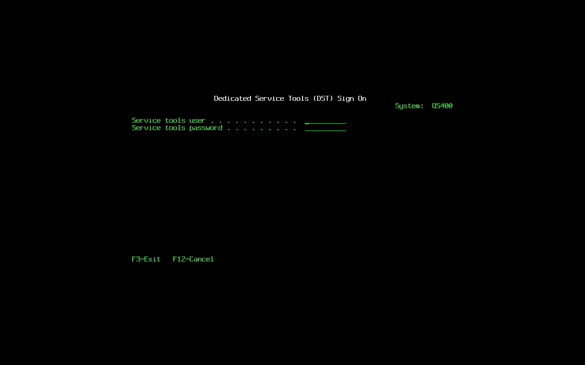
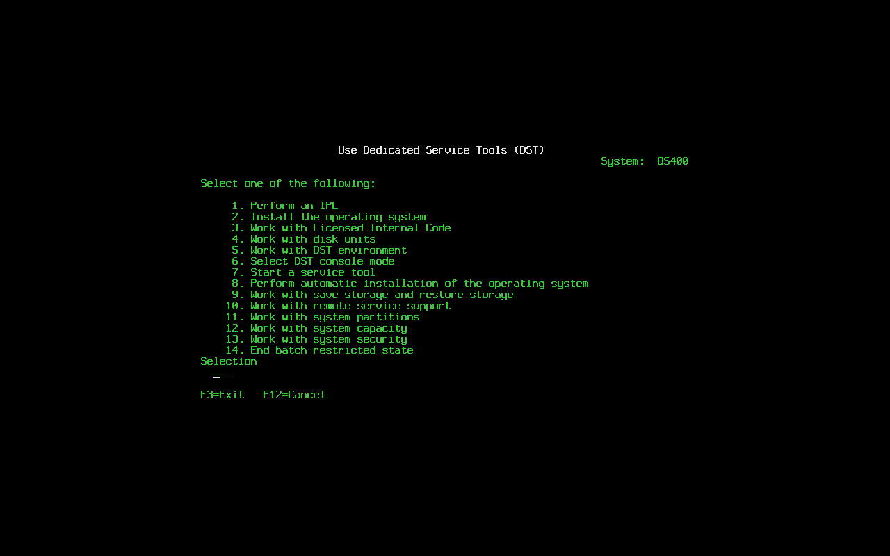
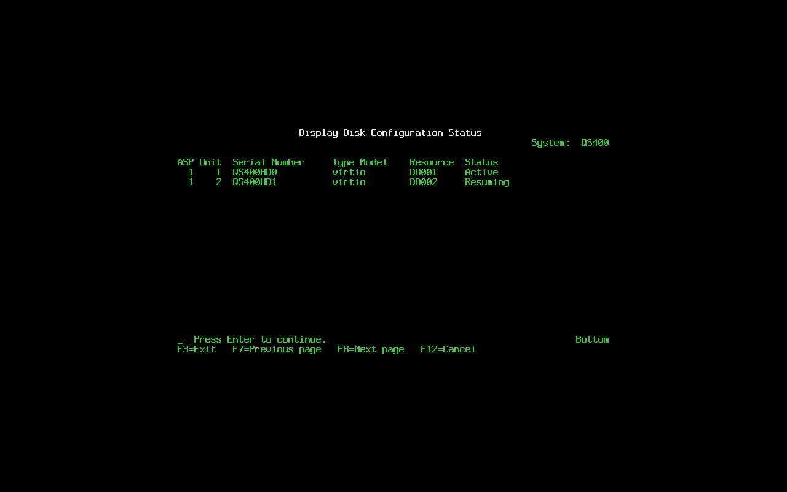

# Dedicated Service Tools

DST is the set of screens that run before the object store is in use:
from option 3 of the attended IPL menu, from a manual IPL that stops on
a missing disk unit (B1001030), and from the installer. The `svctools`
crate holds every screen and the service tools user model; `slic`
provides the system behind them through the `DstEnv` trait and drives
the screens from the console thread. Phase 8's SST shows the same
panels inside a job through another `DstEnv`.

Titles and option numbers are the functional interface and follow IBM's
menus; every sentence on the screens is Quartz's.







## Screen kit

All screens share the geometry of the attended IPL menu, built by
`svctools::ui`:

| Row | Content |
|---|---|
| 1 | title, centered, white |
| 2 | `System:  <name>`, right-aligned |
| 4.. | body: menu options from row 6, list headings on row 6 and rows from row 7, form lines from row 4 |
| 20 | `Selection` on menus |
| 21 | the selection field |
| 23 | function keys |
| 24 | message line (red for errors) |

Panels are a stack (`svctools::panel::Runner`): Enter reports every
input field in order, F12 goes back one panel, F3 back to the first, F10
continues a confirmation, F7 and F8 page a long display. A panel can
push another, replace itself, unwind several with a message, or end the
application with an outcome (`PerformIpl`, `InstallOs`, `AutoInstall`,
`Exit`).

Over serial the same screens are echoed as text and driven with the
service console: `type TEXT` types into the current field, `key NAME`
presses a key (`enter`, `tab`, `backtab`, `fieldexit`, `home`, `f1`..
`f24`, ...), and a line that is not a command is typed into the current
field and entered. `screen` dumps the display.

## Golden files

Every screen has a golden file in `tools/conformance/golden/dst/`, rendered
against a fixed in-memory environment by `lic/svctools/tests/golden.rs`,
`disk.rs` and `environment.rs` and compared whitespace-exact. Run those
tests with `QS400_UPDATE_GOLDEN=1` to rewrite the files after a
deliberate change. The harness step `12 DST sign-on` compares the
guest's own screens with the same files.

| Screen | Golden file |
|---|---|
| Dedicated Service Tools (DST) Sign On | `signon.txt` |
| Change Service Tools User Password | `change-password.txt` |
| Use Dedicated Service Tools (DST) | `main.txt`, `main-not-authorized.txt` |
| Work with Disk Units | `disk.txt` |
| Work with Disk Configuration | `disk-config.txt` |
| Display Disk Configuration (menu, status, capacity, protection, non-configured) | `disk-display.txt`, `disk-status.txt`, `disk-capacity.txt`, `disk-protection.txt`, `disk-nonconfigured.txt` |
| Work with ASP Threshold | `asp-threshold.txt` |
| Work with ASP Configuration, Add Units, Remove Units | `asp-config.txt`, `add-units.txt`, `add-units-confirm.txt`, `remove-units.txt` |
| Work with Mirrored Protection, Start, Stop | `mirror.txt`, `mirror-start.txt`, `mirror-start-confirm.txt`, `mirror-start-confirm-units.txt`, `mirror-stop.txt` |
| Work with Device Parity Protection (no controller; menu), Display Device Parity Status, Start RAID 5 and RAID 6, Confirm, Stop, Include, Exclude and their confirmations | `disk-parity.txt`, `parity.txt`, `parity-status.txt`, `parity-start5.txt`, `parity-start5-three.txt`, `parity-start6.txt`, `parity-start6-three.txt`, `parity-start-confirm.txt`, `parity-stop.txt`, `parity-stop-confirm.txt`, `parity-include.txt`, `parity-include-confirm.txt`, `parity-exclude.txt`, `parity-exclude-confirm.txt` |
| Disk status, protection and replacement with a parity set | `disk-status-parity.txt`, `disk-protection-parity.txt`, `replace-unit-parity.txt`, `replace-confirm-parity.txt` |
| Work with Disk Unit Recovery, Replace, Procedures, Suspend, Resume | `disk-recovery.txt`, `replace-unit.txt`, `disk-procedures.txt`, `suspend.txt`, `resume.txt` |
| Delete Disk Unit Data (select, confirm, Function Status) | `delete-data.txt`, `delete-data-confirm.txt`, `delete-data-status.txt` |
| Work with Licensed Internal Code | `lic-info.txt` |
| Select DST Console Mode | `console-mode.txt` |
| Hot spares: status with a spare, Start/Stop Hot Spare and their confirmations, Start RAID 5 and RAID 6 with Hot Spare and its confirmation | `parity-status-spare.txt`, `spare-start.txt`, `spare-start-confirm.txt`, `spare-stop.txt`, `spare-stop-confirm.txt`, `parity-start5-spare.txt`, `parity-start6-spare.txt`, `parity-start-spare-confirm.txt` |
| Work with Save Storage and Restore Storage, Remote Service Support and its status, Logical Partitioning Environment Not Supported, Work with System Capacity | `save-storage.txt`, `remote.txt`, `remote-status.txt`, `partitions.txt`, `capacity.txt` |
| Work with Service Tools Device IDs, Communications Traces, Service Action Log, Label Location Work Sheet | `device-ids.txt`, `cmn-trace.txt`, `hsm-sal.txt`, `hsm-labels.txt` |
| Work with DST Environment, Active Service Tools, System Devices | `env.txt`, `env-active.txt`, `env-devices.txt`, `env-devices-serial.txt` |
| Work with Service Tools User IDs, Display, Privileges, Create | `users.txt`, `user-display.txt`, `user-privileges.txt`, `user-create.txt` |
| Work with System Values | `sysvals.txt` |
| Start a Service Tool, Product Activity Log, Display/Alter/Dump, LIC Log, Hardware Service Manager | `tools.txt`, `pal.txt`, `dad.txt`, `lic-log.txt`, `hsm.txt`, `hsm-packaging.txt`, `hsm-failed.txt` |
| Work with System Security | `security.txt` |

The installer's screens have their own golden files under
`tools/conformance/golden/install/`, from `lic/svctools/tests/install.rs`:
`lic-menu`, `lic-options`, `load-source`, `lic-confirm`, `disk-status`,
`lic-status`, `device-type`, `os-confirm`, `language`,
`language-confirm`, `os-status`, `ipl-options` and `major-options`. The
sequence they form is described in PHASE2.md.

## Menus

```
Use Dedicated Service Tools (DST)
  1. Perform an IPL                      -> re-IPL (restart)
  2. Install the operating system        -> the installer, on media
  3. Work with Licensed Internal Code    -> release, build, slots (display)
  4. Work with disk units
  5. Work with DST environment
  6. Select DST console mode             -> local or serial, for the next IPL
  7. Start a service tool
  8. Perform automatic installation      -> the installer without prompts
  9. Work with save storage and restore storage
 10. Work with remote service support
 11. Work with system partitions
 12. Work with system capacity
 13. Work with system security
 14. End batch restricted state
```

`Select DST console mode` keeps its choice in the LIC record (TLV
`0x0105`, one byte: 1 local, 2 serial). At the next IPL `slic` opens the
framebuffer and the keyboards only for the local console; in serial
mode the screens exist in memory, are echoed on `ttyS0` and are driven
from the service console as described above. The installer carries the
mode chosen in the media's DST into the record it writes on the load
source.

`Work with disk units`: 1 disk configuration, 2 disk unit recovery,
3 problem recovery and 4 tracing (see below).

`Work with disk configuration`: 1 display (status, capacity,
protection, non-configured units), 2 ASP threshold, 3 ASP configuration
(2 add units, 4 remove units), 4 mirrored protection (1 display, 2
start, 3 stop), 5 device parity protection (1 display status, 2 start
RAID 5, 3 start RAID 6, 4 stop, 5 include a unit, 6 exclude a unit, 7
and 8 start RAID 5 or RAID 6 with a hot spare, 9 start hot spare, 10
stop hot spare), 6 checksum protection and 7 disk compression.

`Work with disk unit recovery`: 3 replace configured unit, 6 problem
recovery procedures, 7 suspend, 8 resume, 10 delete disk unit data.

`Work with DST environment`: 1 active service tools, 2 system devices,
3 service tools user IDs, 4 system values (the LIC-side subset), 5
service tools device IDs (the console; SST's option 8.2 shows the same).

`Start a service tool`: 1 product activity log, 2 trace Licensed
Internal Code, 3 communications traces (the traces `STRCMNTRC` started,
with their status), 4 display/alter/dump, 5 LIC log, 6 main storage
dump manager, 7 hardware service manager (packaging, logical, locate,
failed; 6 the service action log, the product activity log's `A6` and
`B1` entries; 7 the label location work sheet, each resource with its
location).

`Work with system capacity` (12, and SST's 6): processor and storage
capacity displays.

Every other option answers on the message line why its function does
not apply here, or, marked `BLOCKED(rel)`, that it is not in this
release (`svctools::dst::answers`). LIC panels have no message IDs;
the words are Quartz's:

| Option | Answer |
|---|---|
| DST 9.1, 9.2 save and restore storage | `BLOCKED(rel)`: not in this release; `SAVSYS` and the install media save and recover the system (RECOVERY.md) |
| DST 10 remote service support | 1 displays the status (never active); 2 and 4: no ECS line; 3: not active |
| DST 11, SST 5 system partitions | `Logical Partitioning Environment Not Supported`: one system on its hardware |
| DST 12.2, 12.3 temporary and permanent capacity | no capacity on demand; every processor is active |
| DST 14 end batch restricted state | DST runs before the operating system starts and an IPL ends batch restricted state (`ENDSBS *ALL BCHTIMLMT()`), so at DST the system is never in it; on the running system it ends with its job, its time limit, or `ENDJOB` of the job from the console |
| Disk units 3 problem recovery, 4 tracing | no IOP or IOA to recover or trace |
| Disk configuration 6 checksum protection | not supported (gone from IBM i before V7R1) |
| Disk configuration 7 compression | no unit is capable of compression |
| ASP configuration 3 add units and balance data | `BLOCKED(rel)`: balancing waits for the page moves `STRASPBAL` brings; option 2 adds units |
| ASP configuration 6 move units between ASPs | only ASP 1 exists |
| Mirrored protection 4 remote load source mirroring | no remote bus; pairing already prefers another controller |
| Recovery 1, 2, 9 save, restore and copy disk unit data | `BLOCKED(rel)`: no page-level copy of one unprotected unit |
| Recovery 4 assign missing unit | a missing mirrored or parity unit is replaced with option 3 |
| Recovery 5 recover configuration | every unit carries the configuration; each IPL reads it |
| Hardware service manager 8 device concurrent maintenance | devices come and go with the system up |
| SST 4 diskette data recovery | no diskette unit |
| IPL or Install the System 2 and 4 without the media | installing needs an IPL from the installation media |
| IPL or Install the System 5 save Licensed Internal Code | `BLOCKED(rel)`: `SAVSYS` saves it with the system up |

The primary oracle (V7R1M0) shows its `STRSST` sign-on
(`golden/verified/oracle71/sst/sst-signon.txt`); its panels behind the
sign-on need a service tools user ID, which the oracle's credentials do
not include (NEEDS-CODY), so the option numbers and titles above follow
IBM's documentation.

## Hot spares

Device parity option 9 makes a non-configured disk a hot spare of ASP 1
(at most 3, STORE_FORMAT.md §4); options 7 and 8 start a set and take
the smallest non-configured disk at least as large as its largest unit
as its spare, refusing when there is none; option 10 lists the spares
and returns one to the non-configured disks (its header wiped). The
device parity status display lists the spares after the sets, with the
status `Hot spare` and no set or unit number; a spare is never listed
as non-configured nor offered to delete disk unit data.

When a mirrored half fails (Not operational while running, Missing at
an IPL) or a parity member fails, `slic` puts the smallest spare that
fits in its place at once (`storage::use_hot_spares`, from the open and
from the run loop's I/O events): a half resumes from its partner in the
background, a member is rebuilt by the parity work, and the serial log
says `a hot spare took the place of disk unit N`. The attention code
for the failure (A6001255, A6001256, A6001257) is still raised. SST
starts and stops spares through the storage service (request 424, ops
`spare-start` and `spare-stop`). `WRKDSKSTS` lists ASP units only, as
IBM's does: a spare shows there once it has taken a unit's place.
`svc.asp` lists the spares.

## Disk configuration

Rows come from the store's unit table and the hardware table:

```
ASP Unit  Serial Number     Type Model    Resource  Status
  1    1  QM00000           QEMU HARDDISK DD001     Active
  1    2  QM00001           QEMU HARDDISK DD002     Suspended
  1    3  QM00002           QEMU HARDDISK DD003     Unprotected
```

Unit numbers on the displays start at 1; the store numbers units from
0. Status is `Unprotected`, `Active`, `Suspended`, `Resuming nn%`,
`Not operational` or `Missing`. The halves of a pair are listed
together.

- Add units: pick non-configured disks (whole disks with no QS/400
  partitions and no unit header); each becomes an unprotected unit.
  ASP 1 must already have its load source, which only the Licensed
  Internal Code install creates: from the media's DST before that
  install the option answers `ASP 1 has no load source unit`.
- Remove units: data on the unit moves to the other units, then it
  leaves the configuration (only the unit of the last span can leave;
  halves of pairs formed later may follow it and are renumbered).
- Start mirrored protection pairs every unprotected unit of ASP 1,
  unit 1 first (`propose_pairs` in `lic/svctools/src/dst/disk/mirror.rs`):
  1. A non-configured disk at least as large is taken first.
  2. The units left pair with each other, as on IBM i, where half of
     the unit numbers disappear: the lower half keep their data, the
     upper half become their partners, the highest with the lowest.
     A partner's data moves to the other units (the removal above)
     before its pair forms, highest partner first; each removal and
     each pair is checkpointed, so a power loss leaves a valid
     configuration and the option can be run again.
  3. A partner behind another controller is preferred; the
     confirmation shows the level each pair gets, `Controller` or
     `Device` (IBM's levels run bus, IOP, IOA, controller, device;
     this system has no buses or IOPs to tell apart).
  It refuses when every unit already has a partner, when an odd number
  of units is left without a partner, when no unit or disk is large
  enough for a unit, when a partner could not leave because an
  unpaired unit follows it, and when the data in use on the units to
  pair does not fit on the half that keeps it.
  `Confirm Start Mirrored Protection` lists each pair as two rows
  under the first half's unit number, with its protection level; a
  second half marked `data moves` is a configured unit. The copies run
  at the next IPL (`C1001075 Mirrored protection synchronization`),
  one half after another.
- Stop mirrored protection: the chosen half stays, its partner leaves
  the configuration and its header is wiped.
- Replace configured unit: a missing, failed or suspended half is
  replaced by a non-configured disk and the copy starts in the
  background.
- Device parity: the virtual controller the hardware table names
  (`QDPY-001`, the storage controller number after the real ones) owns
  every set; the store keeps the parity (STORE_FORMAT.md §11). Start
  takes 3 to 18 unprotected units for RAID 5, 4 to 18 for RAID 6,
  refuses mirrored ones and units whose tail (the share parity takes)
  holds data, uses the smallest unit's size on every member (the
  confirmation says so when the sizes differ), and computes parity in
  the background (`DPY/Unprotected` in the configuration status until
  done). Include and exclude compute the set's parity again over its
  new units. A missing or failed member shows `DPY/Failed` (A6001257)
  and the ASP stays usable; Replace configured unit puts a
  non-configured disk in its place and rebuilds it (`DPY/Rebuild`). The
  device parity status display uses the words of IBM's: `Active`,
  `Failed`, `Unprotected`, `nn% Resyncing` on every unit of a set being
  synchronized and `nn% Rebuilt` on the unit being rebuilt. A unit in a
  set is never paired by start mirrored protection. The work does not
  hold the IPL: it runs from slic's run loop while the store is slic's
  and goes on in the storage service with the system up
  (STORE_FORMAT.md §11, "Background work").
- Suspend and resume: resume runs in the background; the status column
  shows its percent. A resume started in DST before the IPL, or cut
  short by a power down or a crash, goes on in the storage service with
  the system up; only halves start mirrored protection paired are
  copied during the IPL (C1001075), as IBM does.
- Delete disk unit data (option 10, disk units administration; IBM's
  option of the same number, for non-configured units only): makes
  whole disks blank, for example SSDs holding an earlier install. The
  list (`deletable` in `lic/svctools/src/dst/disk/delete.rs`) is every
  whole disk less those holding a configured unit (the load source,
  mirrored halves) and the reserved ones: the disk the LIC partition is
  on, the install media and any disk with a mounted file system. It
  includes disks with QS/400 or foreign partitions, marked `(has
  data)`. `Confirm Delete Disk Unit Data` warns that the data is lost;
  F10 runs it with a `Function Status` bar per unit. IBM's option writes
  zeros to every page in one pass; this one is quick and says so
  (`diskimg::wipe`): the whole disk is discarded (`BLKDISCARD`; most
  SSDs then read the blocks as zeros), then the first and last 8 MiB
  and the first MiB of every partition either GPT listed are written
  with zeros, so no GPT, unit header, LIC record, FAT or XFS signature
  is left. The kernel re-reads the partition table and the hardware
  resources are rescanned; the disk then shows as non-configured with
  no data, without an IPL. A parity set member is never listed, matched
  by resource and serial as the parity displays show it. A disk holding
  an earlier install counts as non-configured (A6001260 at an attended
  IPL); its blank ASP 1 partition is never taken for a unit.
- A change the store refuses shows the reason on the message line in
  Quartz's words, the unit it is about numbered as the displays number
  units (`svctools::dst::disk::reasons`; LIC screens have no message
  IDs, so these texts are the stable form). The store's own text goes
  to the console log; any other failure still shows only what failed.
  SST makes the same changes through the storage service (requests
  423-425 for the disks, 433-434 for device parity) and shows the same
  reasons.

A D IPL opens the store on demand when a disk option needs it.

## Service tools user IDs

Users live in the LIC record (TLV `0x0102`), separate from the
operating system's user profiles, as on IBM i. Passwords are
Argon2id hashes in PHC form. Three wrong passwords disable the ID; a
user with the user ID privilege enables it again. A new or reset
password is expired: the first sign-on goes through `Change Service
Tools User Password`. The last ID with the user ID privilege cannot
lose it or be deleted.

Shipped IDs and privileges:

| User | Default password | Privileges |
|---|---|---|
| QSECOFR | QSECOFR, expired | all |
| QSRV | QSRV | all but security and user IDs |
| 11111111 | 11111111 | disk operations, logs, hardware, IPL |
| 22222222 | 22222222 | disk operations, IPL |

Privileges: disk units administration, disk units operations, service
tool security, service tool user IDs, system values, display/alter/dump,
logs, hardware service manager, install, IPL, dumps and traces.

## Other records in the LIC partition

- Product activity log: attention and fatal reference codes with their
  times, the newest 64, as reserved TLVs (`0x0003`); `slic` records one
  whenever it emits an `A6`/`B1` code.
- Security flags: one byte under TLV `0x0103` (allow default-password
  change, new certificates, system value security changes, add
  certificates); only the first and third have an effect.
- Resume journal: at offset 1 MiB, the chunk bitmap of a mirrored half
  being copied, so a crash continues where it stopped, then one byte: 1
  for an operator's resume, which goes on with the system up, 0 (or
  absent) for the synchronization start mirrored protection leaves to
  the IPL.
