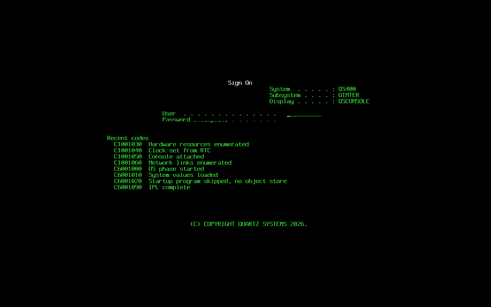

# Phase 1: PID 1, IPL, system values, console

What Phase 1 built on top of Phase 0, how to run it, and the evidence for
the acceptance criteria. QS/400 is x86_64 only.

## Crates

```
licpart/      LIC partition: A/B record store, GPT locate
sysval/       system value catalog, validation, time zones, LIC storage
console/      5250-style console: font, framebuffer, screens, keyboard
slic/         PID 1: the IPL state machine, service console, power down
conformance/  QEMU harness: the six Phase 1 steps
build/        orchestrator (slot A/B UKIs, LIC partition, --release)
```

Everything persisted in Phase 1 lives in the LIC partition and is marked
`MIGRATE(phase2)` in the code; it moves into the object store when that
exists.

## The IPL

`build uki` bakes `qs400.slot=A` or `=B` into each UKI (they differ only in
that); `build disk` puts slot A at `EFI/BOOT/BOOTX64.EFI` and slot B at
`EFI/QS400/B.EFI`. Dev builds also carry `qs400.svc=1`, which enables the
serial service console; `build uki --release` and `build all --release`
leave it off. `qs400.mode=normal|manual` sets the keylock; without it, the
LIC record's `next_mode` (set by `mode manual` on the service console) is
used once, else normal.

### SRC table

| Code | Phase | Meaning |
|---|---|---|
| C1001000 | LIC | IPL started |
| C1001010 | LIC | LIC partition located |
| C1001020 | LIC | LIC record read (or initialized on first boot) |
| C1001030 | LIC | Hardware resources enumerated |
| C1001040 | LIC | Clock set from RTC |
| C1001050 | LIC | Console attached |
| C1001060 | LIC | Network links enumerated |
| C1002000 | LIC | Previous IPL was abnormal (informational, continues) |
| C6001000 | OS | OS phase started |
| C6001010 | OS | System values loaded |
| C6001020 | OS | Startup program skipped, no object store (`MIGRATE(phase5)`) |
| C6001090 | OS | IPL complete |
| A6005008 | attention | Console not found, continuing on serial |
| B1001000 | fatal | slic panic |
| B1001010 | fatal | LIC partition not found |
| B1001020 | fatal | LIC record unreadable, both copies |
| D1001000 | power down | Power down started |
| D1001090 | power down | Power down complete |

The table is [slic/src/src.rs](../slic/src/src.rs). Every transition prints
`SRC <code>  <text>` on serial and `/dev/console`, updates the SRC display,
and is kept in an in-memory log (`srcs` on the service console). Fatal
codes write a history record with outcome Failed and park; nothing reboots
on its own in Phase 1.

### Abnormal IPL

The LIC header carries `ipl_in_progress`. It is set after the record is
read and cleared at C6001090. Finding it set at the next start means the
previous IPL never completed (power loss, kill): C1002000 is emitted,
`abnormal_count` increments, a history entry with outcome Abnormal is added
for the previous IPL, and QABNORMSW reads `1` for this IPL.

### Manual mode

Boot with `qs400.mode=manual` on the command line, or type `mode manual` on
the service console before `pwrdwn restart`. After C1001050 the "IPL or
Install the System" menu appears on the display and, as text, on serial.
Option 1 continues the IPL; 2 to 5 answer "Option not available in this
release". The selection can be typed on the local keyboard (Enter) or on
serial.

### Hardware resources

Coldplug walks `/sys/bus/pci/devices`, `/sys/class/block`, `/sys/class/net`,
`/sys/class/tty` and `/sys/class/input`; a `NETLINK_KOBJECT_UEVENT` socket
then tracks hotplug for the life of PID 1. Names are assigned in PCI
address order so they are stable across boots: `CMBnn` bridges, `LINnn`
network functions (interfaces are noted as ports), `DCnn` storage
controllers, `DDnnn` disks, `OPTnn` optical, `CMNnn` serial ports, `KBDnn`
keyboards, `OTHnn` everything else. `hw` on the service console prints the
table and the network links. Phase 10 turns this into WRKHDWRSC.

### Clock and network

The kernel does not set the clock (`RTC_HCTOSYS=n`); slic reads `/dev/rtc0`
with `RTC_RD_TIME`, treats it as UTC, calls `clock_settime`, and re-stamps
the IPL start time. Network: rtnetlink lists links and brings `lo` up;
nothing else.

### Power down

`pwrdwn` or `pwrdwn restart` on the service console, or `SIGUSR1` to PID 1:
D1001000, the LIC record is finalized (in-progress cleared, history
written if the IPL never completed), `sync`, `/run` `/dev` `/sys` `/proc`
are unmounted in that order, D1001090, then `reboot(2)` with
`RB_POWER_OFF` or `RB_AUTOBOOT`. The unmounts are lazy (`MNT_DETACH`):
slic still holds the console and serial port open to print D1001090, so a
synchronous unmount of `/dev` would fail with `EBUSY`.

### Service console

Serial, `/dev/ttyS0`, prompt `QS400-SVC> `, only with `qs400.svc=1`.
Commands: `help`, `srcs [table]`, `hist`, `hw`, `lic`, `sysval NAME
[VALUE]`, `mode manual|normal`, `screen`, `pwrdwn [restart]`. No shell, no
filesystem commands.

## LIC partition

`QS400-LIC`, 64 MiB, raw, right after the ESP. GPT type GUID
`a0b7c2f4-5e13-4d9a-9f31-515334304c49`, located by scanning the GPT of
every whole disk under `/sys/class/block` and resolving the partition by its
sysfs `partition` index. Device names are never assumed.

Two copies of one record at offsets 0 and 64 KiB. A write goes to the older
or invalid copy with the next sequence number, then `fsync`; a read takes
the newest copy whose CRC verifies. A torn write can only damage the stale
copy; the unit test in [licpart/tests/torn.rs](../licpart/tests/torn.rs)
cuts a write 100 bytes in and checks the previous record is served and the
torn slot is reused next.

Record layout, little-endian:

```
0   magic "QS400LIC"          8
8   format_version   u32      4   (1)
12  record_len       u32      4   bytes from offset 0 to the end of the TLVs
16  crc32c           u32      4   over [20, record_len)
20  sequence         u64      8
28  header                    24  see below
52  tlv_count        u32      4
56  TLVs: tag u16, len u32, data
```

Header: `ipl_in_progress u8`, `last_ipl_type u8` (A B D), `last_ipl_mode u8`
(Normal Manual), `last_slot u8`, `last_good_slot u8`, `next_mode u8` (0
none, 1 normal, 2 manual), 2 reserved, `ipl_count u32`, `abnormal_count
u32`, `install_time u64`. TLV tags below `0x0100` are reserved; `0x0002`
holds one IPL history record (28 bytes: start, end, type, mode, slot,
final SRC as 8 ASCII bytes, outcome), at most 16 kept. `0x0100` holds the
system value overrides.

First boot: both copies invalid, `init` writes the defaults with
`install_time`. A partition with one valid copy is never reinitialized.

## System values

[sysval/catalog.toml](../sysval/catalog.toml) has 155 entries, one per
IBM i name, each with type (`char`, `dec`, `list`), length or elements,
Quartz default, allowed set or range, `restart_required`, `readonly`,
Quartz-written text and group. It is compiled in with `include_str!`; a
unit test fails the build on a parse error, a duplicate, missing text, or a
default that breaks the entry's own rules.

API (`sysval::SysVals`):

- `from_record(&Record, &HostInfo)` / `load(&mut LicPart<D>, &HostInfo)`.
- `get(name) -> Value`. Clock-derived values (QDATE, QTIME, QYEAR, QMONTH,
  QDAY, QHOUR, QMINUTE, QSECOND, QCENTURY, QDAYOFWEEK, QDATETIME,
  QUTCOFFSET) are computed from the system clock through QTIMZON and
  QDATFMT and are read-only.
- `set(name, Value)` and `set_text(name, &str)`: validated against type,
  length, allowed set or range; read-only values are refused; returns
  `Effect::Immediate` or `Effect::NextIpl` for `restart_required` values.
- `set_system(name, Value)` for values the IPL sets (QABNORMSW, QIPLSTS).
- `store(&mut Record)` / `save(&mut LicPart<D>, &mut Record)`: only
  overrides are stored, as TLV `0x0100`, so defaults can evolve.

QMODEL is `QS40`, QPRCFEAT `QS01`, QSRLNBR seven characters hashed from
the DMI product UUID (`CONFIG_DMIID`), falling back to the product and
chassis serials. The harness passes a fixed `-uuid`, which yields
`VM1K2JR`.

Time zones: 28 `Qxxxx` descriptions in [sysval/src/tz/](../sysval/src/tz/)
with the US, EU, south-eastern Australian and New Zealand daylight rules
coded from the calendar. No tz database is involved. Setting QTIMZON
changes QTIME and QUTCOFFSET immediately.

## Console

### Font

[console/font/qs400-9x16.txt](../console/font/qs400-9x16.txt): 107 glyphs
drawn by Quartz as text art, 9×16 cells, two-pixel strokes, printable
ASCII plus eleven box-drawing characters and the 5250 column separator
(private use U+E000). `build.rs` compiles it to a table; a test requires
every printable ASCII glyph to be present and non-empty.

### Display

`/dev/fb0` at 32 bpp XRGB only; anything else raises A6005008 and the IPL
continues on serial. The frame buffer console is detached through
`/sys/class/vtconsole/*/bind` and the VT is put in graphics mode, otherwise
fbcon repaints over the screen. Pixels are written with `pwrite` in pieces
under a page followed by `fsync`: under simpledrm's fbdev emulation,
single writes over a page lost damage and `mmap` writes were never flushed.
The 80×24 grid is centered on the display. Palette: black background,
green text, white for high intensity, red for errors, plus blue,
turquoise, pink and yellow.

Screens: the SRC display (current code double width, last eight below),
the IPL menu, and the sign-on display at the classic geometry with Quartz
wording. `screen` on the service console returns the 24×80 grid as text,
which the harness compares.

### Keyboard

Every `/dev/input/event*` that reports keys is read. The 5250 map (US
layout):

| Key | 5250 |
|---|---|
| Enter, keypad Enter, Right Ctrl | Enter |
| Tab / Shift+Tab | Field Advance / Field Backspace |
| Keypad +, Right Shift | Field Exit |
| Backspace | Backspace within the field |
| Home, Insert, Delete | Home, Insert toggle, Delete |
| F1 to F12, Shift+F1 to F12 | F1 to F24 |
| Esc | Attention (no-op in Phase 1) |
| Ctrl+Left | Reset |
| Arrows | cursor, confined to input fields |

Field rules: the cursor stays inside input fields, typing past the last
cell autoskips to the next field, Field Exit clears to the end of the
field and advances, insert mode shifts the rest of the field, nondisplay
fields keep their text but show nothing. Enter on the sign-on display shows
"Sign-on not available in this release" in red and inhibits the keyboard
(`X II` bottom left) until Reset.



## Build changes

- `build disk` adds the LIC partition; `build uki` builds both slots;
  `--release` on `uki` and `all`.
- Kernel fragment and the enforced list gained `DRM_FBDEV_EMULATION`,
  `INPUT_EVDEV`, `RTC_CLASS`, `RTC_DRV_CMOS`, `DMIID`, and `RTC_HCTOSYS=n`
  (68 symbols checked).
- The harness runs QEMU with `-vga std` (pinned), `-device
  virtio-keyboard-pci`, `-rtc base=utc`, a fixed `-uuid`, and a QMP Unix
  socket. It works on a copy of the image under `target/conformance/`, so
  state persists across restarts and the built image stays pristine.

## Running

```
cargo run -p build -- all          # dev build, service console on
cargo run -p build -- test         # the six-step suite
cargo run -p build -- all --release
QS400_QEMU=1 cargo test -p conformance
```

The six steps: SRC sequence in order within 60 s; rows 1 to 10 of the
sign-on display exact; `sysval QMODEL` is QS40 and QSECURITY set to 50
reads back 50; `pwrdwn restart` shows D1001000 and D1001090, the next IPL
reaches C6001090, `hist` has two entries with the first Normal; a guest
killed after C1001030 shows C1002000 on the next boot with QABNORMSW 1;
`screendump` of the sign-on display is saved to
`target/conformance/signon.png`.

## Acceptance evidence

Measured 2026-10-10 in WSL Ubuntu 26.04, Rust 1.98.0, clang 21.1.8, QEMU
10.2.1, OVMF 2025.11.

| # | Criterion | Result |
|---|---|---|
| 1 | `build all` and `build test` pass; six steps green | pass: KVM about 6 s for the steps, TCG about 20 s |
| 2 | `licpart` torn-write unit test | pass (`cargo test -p licpart`, 12 tests) |
| 3 | catalog parses, no duplicates, every entry has text | pass, enforced by a test; 155 entries |
| 4 | font compiles and every printable ASCII glyph is non-empty | pass, enforced by a test; 107 glyphs |
| 5 | clippy warning-free; `cargo deny check` passes; `slic` has no `PT_INTERP`/`DT_NEEDED` | pass: 0 warnings on Linux and Windows hosts and for the musl target; 151 crates compiled, no `links`, no C build helpers; `build userland` checks the ELF every build (slic is 1 018 472 bytes, static-pie, stripped) |
| 6 | PHASE1.md and CLAUDE.md | this commit |

Final run on 2026-10-10: `build all` 2 m 51 s wall (two UKI relinks), both
UKIs 14 627 840 bytes, `cargo test --workspace` 58 tests passed, the suite
green under KVM.

Step timings from `build test` under KVM: sequence 1.6 s, screen 0.1 s,
system values 0.0 s, restart 1.3 s, screenshot 0.1 s, abnormal 3.0 s.
Under TCG: 4.1, 0.3, 0.0, 5.8, 0.3, 8.0 s.

## Deviations from the Phase 0 code and the Phase 1 text

- The Phase 0 heartbeat SRC (C1001005) is gone; the harness asserts the
  Phase 1 sequence instead.
- Unmounts at power down are lazy, see above.
- Enter on the sign-on display is handled inside the console thread; slic
  only hears about menu selections and function keys.
- `RANDOM_TRUST_CPU` still does not exist in 6.18 (see ARCHITECTURE.md).
