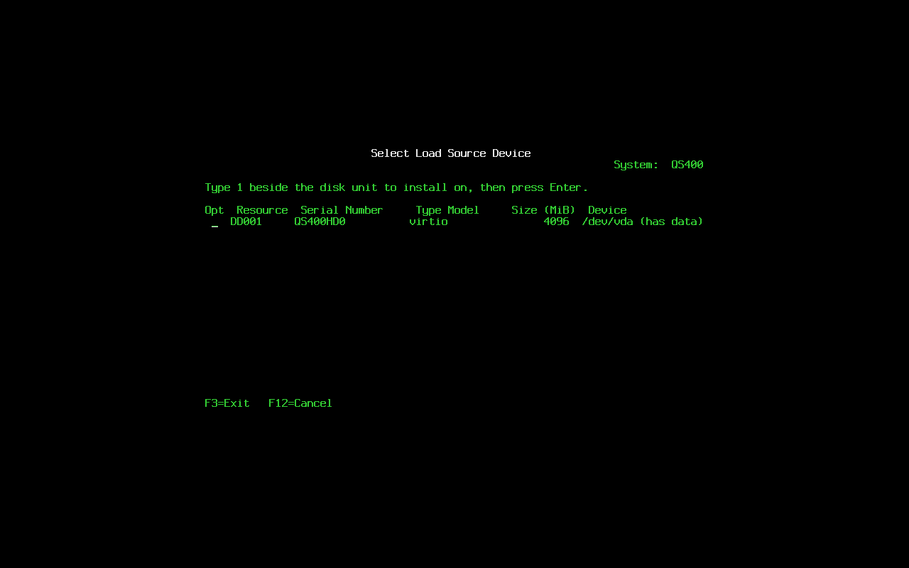
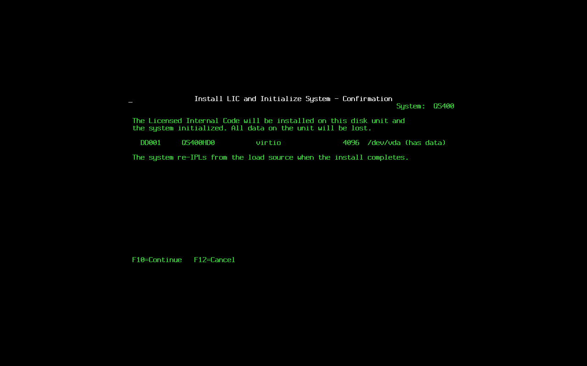
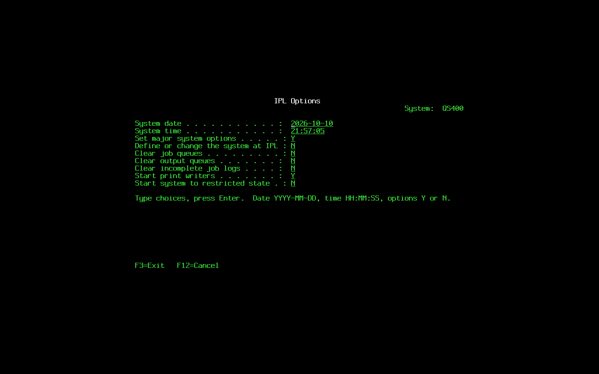
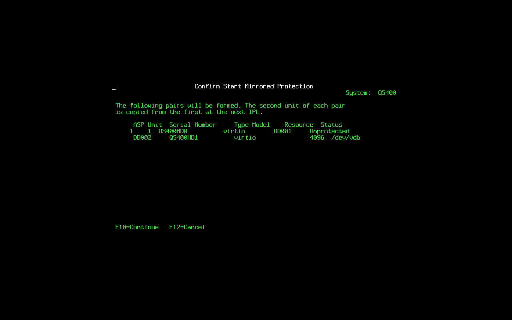
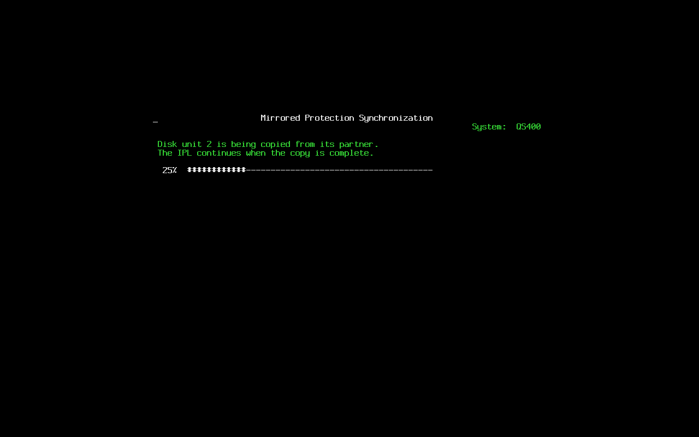

# Phase 2: storage and the object store

What Phase 2 built on top of Phase 1, how it is laid out on disk, how it
recovers, how to drive it, and the evidence for the acceptance criteria.
The byte-level formats are in `STORE_FORMAT.md`; this file is the design
and the operations view. QS/400 is x86_64 only.

## Crates

```
blockdev/     BlockDev trait; LinuxBlockDev (O_DIRECT); MemBlockDev with
              fault injection (fail_after, tear_at, drop_unflushed)
store/        the object store, bottom up:
  src/page/     4 KiB pages with a CRC32C trailer; the Pager trait; MemPager
  src/btree/    copy-on-write B+tree: fixed keys, variable values, bulk load
  src/asp/      units, superblock, logical page space, page I/O
  src/alloc/    bitmaps, free-space tree, free log, checkpoint chunks
  src/wal/      the ring, one record per transaction
  txn.rs        transactions: the Pager trees write through, patches, roots
  store.rs      open with recovery, commit, checkpoint, close, page cache
  cache.rs      CLOCK page cache, write-through
  src/obj/      IDs, headers, the type registry, directories, libraries,
                locks, generic operations, space.rs (byte space over
                extents), dtaara, dtaq (and *USRQ), usrspc, usridx, sysval
  reclaim.rs    RCLSTG
qsname/       10-byte CP037 object names and the special values
ccsid/        CP037 <-> UTF-8 from cp037.csv, EBCDIC collation
diskimg/      the disk layout (ESP, LIC, ASP1), FAT volumes, ISO 9660
              reader, GPT lookup; used by build disk and the installer
slic/         src/ipl/storage.rs (ASP 1 at IPL, QTEMP), sysvals.rs (the
              *SYSVAL object), install.rs (the ISO installer),
              src/svc/objects.rs and storage.rs (console commands)
conformance/  src/phase2.rs: the Phase 2 steps of the disk suite
```

## Design

**Blocks.** Everything goes through `BlockDev`: 4 KiB blocks, `read`,
`write`, `flush`, `discard`. On Linux the backend opens the partition
with `O_DIRECT` and bounces unaligned buffers through `AlignedBuf`;
`flush` is `fdatasync`. Every store test runs on `MemBlockDev`, which
models a volatile write cache: writes are readable at once but reach the
flushed image only on `flush`, and the test can make a write fail, tear
a write at a seeded point, or drop everything unflushed.

**Pages.** A page is a 4064-byte body and a 32-byte trailer: CRC32C,
page type, owning object ID and the writing transaction. The CRC covers
the body and the rest of the trailer. A mismatch is a hard error naming
the page and the owner; nothing reads a bad page silently.

**B+tree.** One generic `BTree<K, V>`: fixed-size big-endian keys (so
byte order is key order), variable values up to 1024 bytes, point get,
floor, range scan, insert, delete with merge or rebalance, bulk load at
90% fill. Copy-on-write: a change rewrites the touched nodes to fresh
pages and the caller publishes the new root. A node the current
transaction allocated is rewritten in place, since nothing else can see
it yet. The property test runs 100,000 random operations against
`BTreeMap` per seed with commits and power pulls mixed in.

**ASP.** An ASP is one or more units concatenated into one logical page
space. Each unit has a unit header at page 0 and a backup at its last
page, and two superblock copies at pages 1 and 2 written alternately by
checkpoint generation; the newest valid copy across all units wins. The
superblock records the creating release, and a store from another V or
R is refused (CPF3294). Phase 2 supports ASP 1 with one unit; the unit
table allows up to 119.

**Allocator.** Between checkpoints the per-unit bitmaps are the truth:
first fit in the unit with the most free space, the largest run when
nothing fits, and `extend` grows an object's last extent in place. A
page freed by a transaction is not reusable until the checkpoint after
it. At a checkpoint the free-space tree is bulk-loaded fresh from the
bitmaps; its pages come from chunks taken from the free runs first, and
the unused chunk tails go into a one-page free log that the next
checkpoint folds back in. Everything a checkpoint writes lands on pages
the previous superblock calls free, so a crash at any point leaves the
previous checkpoint intact. The allocator keeps 1/64 of the ASP back so
a full store can still checkpoint.

**WAL and transactions.** Every change is a transaction. Pages the
transaction allocates (new headers, data pages, tree nodes) are buffered
in memory and written at commit before the WAL record; in-place changes
to existing pages (data area values, queue entries, user space bytes,
header fields, directory roots) are logged as a whole page image on the
first change of a page since a checkpoint and as byte patches after
that. Commit order: the new pages and every record page but the last,
flush every unit, then the last page, flush unit 0. A valid last page
proves the transaction durable. Recovery at open replays every complete
record from the WAL tail, stops at the first incomplete or bad one, and
checkpoints. The ring is 64 MiB; a transaction that would not fit is
refused and the store stays usable; a full ring forces a checkpoint.
Checkpoints also run every 256 transactions and every 30 seconds.

**Page cache.** CLOCK replacement, write-through, so it never holds
dirty committed data. Since Phase 5 it lives in the storage service,
which sizes it as the *MACHINE pool from `QMCHPOOL` once the system
values are read (256 MiB before that).

**Objects.** IDs are 128 bits: ASP, type code, a serial that is never
reused, and a generation. The object directory (ID to header page) is a
B+tree whose root lives in the superblock and is published by the WAL.
Every object has one header page with the identity, ownership,
timestamps, authority (stored, not enforced), storage (16 inline extents
plus an overflow page) and a 1 KiB type-specific attribute area; the
rest of the page is reserved for the database and journaling phases.
Each library owns a directory tree keyed by type and CP037 name, whose
root sits in the library's attribute area, so a scan lists objects in
EBCDIC order. The registry lists every type from the plan plus the
internal `*SYSVAL`. Every type gets create, delete (needs `*EXCL`),
rename, move, change text, describe and listing; `resolve` walks
`*LIBL`, `*CURLIB` or a named library. Locks are an in-process table
with the standard five-state matrix, held per job handle.

**Data types.** A byte space over an object's extents (4064 bytes per
page) carries `*DTAARA` values, `*DTAQ` and `*USRQ` entries, `*USRSPC`
bytes and the `*SYSVAL` blob; every write is an in-place change logged
through the WAL. Queues append at the tail, receives mark entries dead,
and an emptied queue resets to reclaim its space. `*USRIDX` entries live
in a B+tree owned by the index with a 128-byte key (the entry key
zero-padded plus an insertion sequence, so equal keys keep age order);
find and remove take EQ, NE, GE, GT, LE, LT, and there are first-N and
last-N.

**Names and characters.** `qsname::Name` is the stored 10-byte CP037
form with the unquoted and quoted rules; `Ord` is EBCDIC order. `ccsid`
holds the CP037 table as a committed CSV written from the code page
layout and converts both ways; `ebcdic_cmp` puts `$`, `#` and `@` before
letters and letters before digits.

**RCLSTG.** `rclstg` sweeps every page of every unit in 1 MiB reads,
verifies every allocated page, checks each object's extents, overflow
page and index tree, diffs the object directory and every library
directory against the headers, and reconciles the allocator. `*CHECK`
reports; `*ALL` (and `*SYSBAS`, the same in Phase 2) rebuilds the
allocator from the references, marks objects with bad pages damaged,
moves objects whose library is gone to QRCL, bulk-loads every
directory, clears `rclstg_required` and checkpoints. Liveness of a
header is decided by the allocator: a valid header on a free page is a
deleted object, counted as stale and ignored.

## The IPL

New codes, in the order they appear:

| Code | Phase | Meaning |
|---|---|---|
| C1001070 | LIC | ASP units located (every ASP 1 partition and every whole disk with a unit header) |
| C1001075 | LIC | Mirrored protection synchronization: a resuming half is copied before the store is used |
| C1001080 | LIC | Storage management recovery: WAL replayed, count on serial; a blank unit is formatted here |
| C1001085 | LIC | Storage management recovery failed; followed by B1001040 |
| C1001087 | LIC | Store release mismatch, both releases on serial; followed by B1001050 |
| C6001005 | OS | Object store opened |
| C6001007 | OS | ASP 1 initialized: QSYS, QGPL, QUSRSYS, QSYS2, QRECOVERY, QSPL, QRCL, QHLPSYS (first boot only) |
| C6001008 | OS | Reclaim storage required (`rclstg_required` set) |
| C6004001..C6004090 | OS | The LIC install: started, load source partitioned, LIC partition initialized, slot A, slot B, LIC record written, installed |
| C6004100..C6004190 | OS | The operating system install: pending, ASP 1 initialized, system libraries created, installed |
| A6001255 | attention | Mirrored unit missing, protection suspended |
| A6001256 | attention | Mirrored unit not operational, protection suspended |
| A6001260 | attention | Disk unit not configured (disks beyond the load source at a pending install) |
| B1001030 | fatal | ASP 1 unit not found on an A or B IPL |
| B1001040 | fatal | Object store unusable |
| B1001050 | fatal | Object store created by another release |
| D1001010 | power down | Object store checkpointed and closed, before the unmounts |

On an A or B IPL the store opens right after hardware enumeration. On a
D IPL it opens after the attended menu, because option 2 may be about to
rewrite the disk; with no ASP unit a D IPL continues without a store.
The run loop wakes every five seconds for the time-based checkpoint.

**QTEMP.** ASP 0 is a 64 MiB `MemBlockDev` formatted at every IPL with
the same code, with a root library called QTEMP. Since Phase 5 every
job has its own, a library `QTnnnnnn` in this ASP's root seen as
`QTEMP`. `QTEMP/NAME` on the service console addresses the console
job's.

**System values.** They live in the `QSYSVAL` object (`*SYSVAL`, in
QSYS) as the `sysval` crate's TLV blob. On the first boot after the
store exists, the overrides in the LIC record migrate into the object
and the LIC record keeps only the IPL subset (QIPLTYPE, QPWRRSTIPL,
QRMTIPL, QABNORMSW, QIPLSTS, QCONSOLE, QAUTOCFG) under TLV tag 0x0101;
tag 0x0100 is dropped. Every save writes the object and the subset.
Without a store (media IPL, no disk) the LIC record is used as before.

## Disk layout

`build disk` writes a 4 GiB image by default (`--size` overrides): the
256 MiB ESP at 1 MiB, the 64 MiB `QS400-LIC` partition, then
`QS400-ASP1` (type GUID `3c5a9d7e-2b41-4c6f-9e08-515334304131`) to the
end, 4 KiB aligned. The layout lives in `diskimg`, which the installer
uses on a real disk. The image is sparse; the hashes in `build disk`
and `build manifest` read the whole 4 GiB.

## Install media and the installer

`build iso` puts the media UKI in the El Torito boot image and the slot
A and B UKIs beside it as `QS400A.EFI` and `QS400B.EFI`, since the media
UKI's command line is the D-IPL one. The installer follows the IBM
sequence; its screens are `svctools::install`'s (golden files under
`tools/conformance/golden/install/`), the work is `lic/slic/src/ipl/install.rs`.

**Licensed Internal Code.** On a D IPL, option 2 of the attended menu:
`Install Licensed Internal Code` (1 install, 2 DST, 3 not available),
`Install Licensed Internal Code (LIC)` (only 2, install and initialize
the system, works), `Select Load Source Device` (every whole disk, with
resource name, serial, type and size; disks that carry QS/400 data are
marked), `Install LIC and Initialize System - Confirmation` (F10), then
`Initialize the Disk - Status` with a percent bar while the partition
table and the ESP are written, and `Install Licensed Internal Code -
Status` ticking off the partitioning, the LIC partition, the two slots
and the LIC record. Serial sees the same steps as C6004001 to C6004090.
The LIC record is written with the operating system install pending,
and the system re-IPLs. Option 4 does the same onto the first disk with
no prompts and marks the pending install automatic.

**The operating system.** The next IPL, from the media or from the disk
alike, finds the pending install (C6004100). An automatic one runs at
once. Otherwise the IPL lands in DST (sign-on; `A6001260 Disk unit not
configured` when disks beyond the load source are present), where
option 2 runs `Install Device Type Selection` (only optical), `Confirm
Install of the Operating System` (F10), `Select a Language Group` (2924
English; the table takes more), `Confirm Language Feature Selection`
(F10) and `Install the Operating System - Status`: ASP 1 is formatted,
QSYS and the system libraries created (C6004110, C6004120). The IPL
goes on; once the system values exist, `IPL Options` (date, time and the
seven choices, kept in the LIC record under TLV 0x0104; only `Start
print writers` acts, through `QSTRPRTWTR`) and, when asked, `Set Major
System Options` (`QAUTOCFG`, `QDEVNAMING`, `QSPCENV`). C6004190 clears
the pending stage and the IPL reaches sign-on. An automatic install
takes every default and asks nothing.







The disks come from `/sys/class/block`; the UKIs are read from the first
optical device whose ISO 9660 volume id starts with `QS400`. The
partition table is written with `diskimg::write_image_with` (random
GUIDs, progress per chunk), the kernel re-reads it (`BLKRRPART`), and a
D IPL that had the target disk's LIC partition open first swaps that
handle for an in-memory copy of the record, since the kernel refuses
`BLKRRPART` while a partition on the disk is open.

## Mirrored protection and Dedicated Service Tools

Addendum 2.5 added mirrored pairs to the store, Dedicated Service Tools,
and the install flow above. The unit table is version 2 (every unit
carries its state, usable size, partner and serial; see
STORE_FORMAT.md §4 and §5); DST and the service tools user IDs are
described in DST.md. In short:

- A span is one unprotected unit or a mirrored pair. Writes go to both
  halves and `flush` waits for both; reads alternate; a page that fails
  verification on one half is read from the other and rewritten;
  `chkstg` compares the halves. A half that fails I/O is taken out of
  service (A6001256); a half not found at IPL leaves the pair running on
  one half (A6001255); a missing unprotected unit stops the IPL with
  B1001030 and the service tools.
- A suspended or returned half is resumed in 1 MiB chunks, in the
  background from the run loop, with the chunk bitmap journaled in the
  LIC partition (offset 1 MiB) so a crash continues where it stopped; a
  half found resuming at IPL is synchronized before the store is used
  (C1001075).
- Units are added, removed (their data moved off first), paired and
  dissolved through DST; the service console has `unit` and `mirror`
  commands for the same operations, and `key`, `type` and `screen` to
  drive any screen over serial.





The screenshots come from the harness: every `build test` run that
passes leaves them under `target/conformance/`, and the ones here were
copied from one.

## Service console

```
asp                  units, free and available pages, WAL fill, generation, release, flags
lib ls               every library (ASP 1 then QTEMP), EBCDIC order, object counts
obj ls LIB [TYPE]    entries of a library
obj crt TYPE LIB/NAME [TEXT]   create (defaults for *DTAARA, *DTAQ, *USRSPC, *USRIDX)
obj dlt|rnm|mov ...  delete, rename, move
obj dsp LIB/NAME     description, every type of that name
obj bench N          N data areas over QBENCH0..9, created then deleted, rates
dtaara get|set LIB/NAME [VALUE]
dtaq snd|rcv LIB/NAME [DATA]
usrspc rd LIB/NAME OFFSET [LEN] | wr LIB/NAME OFFSET TEXT
rclstg [*CHECK]      reclaim storage, or verify only
chkstg               checksum sweep of every allocated page
txn stats            commits, aborts, checkpoints, WAL pages, images, patches, cache
```

`obj bench` commits a thousand objects per transaction and checkpoints
every four batches, deletes leftovers of an interrupted run first
(untimed), then times creation and deletion.

## Crash tests

Unit level (`storage/store/tests`): the B+tree against `BTreeMap` with crashes
between operations; a torn page write before commit; a corrupted
committed page naming page and owner; the allocator under random
allocation with a torn write at every position of a checkpoint; a
damaged superblock copy; committed transactions surviving a power pull
between commits over forty rounds while uncommitted and aborted work
vanishes; a torn write at every position of a commit yielding the
state before or after, never a mix; each data type across a power
pull; RCLSTG on zeroed directory pages, a bad payload page and a lost
library.

Harness level (`build test`), after the Phase 1 steps:

| Step | What |
|---|---|
| 7 libraries | C6001007 on the first boot; `lib ls` shows the eight system libraries in EBCDIC order |
| 8 sysval in store | QSECURITY is 50 from `*SYSVAL`; `lic` shows tag 0x0101 and no 0x0100 |
| 9 object bench | `obj bench N`, `rclstg *CHECK` clean, `pwrdwn restart`, the next IPL replays 0 |
| 10 power pulls | per seed: boot, `obj bench 200000`, kill QEMU after 1.5 to 7.5 s, boot, C1001080, `chkstg` 0 bad, `rclstg *CHECK` 0 problems, the QBENCH counts are a state only whole committed batches leave (equal, or emptied in library order by the leftover delete), at most 200000 in all |
| 11 mirrored pair | `mirror start 0 /dev/vdb` with a second blank disk, `mirror resume 1` to completion, `asp` shows two Active halves and `protection: mirrored`, `chkstg` clean across a restart; boot without the second disk: A6001255, `asp` shows Missing, an object is created on one half; boot with it again: Suspended, `mirror resume 1`, `chkstg` and `rclstg *CHECK` clean, the object is there |
| 12 DST sign-on | `mode manual`, restart, option 3, a wrong password, QSECOFR's expired default, the forced change, the main menu, each screen equal to its golden file, option 1 IPLs, the LIC record holds the user IDs (tag 0x0102) |

`build test` runs the bench with 20,000 objects and 3 pulls;
`--bench 1000000 --pulls 10` is the CI size and `--pulls 100` the local
one. `build test --media iso --install` runs the install suite:

| Step | What |
|---|---|
| 1 automatic install | option 4 on a blank 4 GiB disk, C6004090, re-IPL from the media, C6004100, the operating system installed without prompts, sign-on |
| 2 boot installed disk | the disk alone IPLs to sign-on |
| 3 interactive install | option 2 over the installed disk through every screen over serial: LIC menus, load source, F10, re-IPL into DST, sign-on with the forced password change, the operating system screens, IPL options, major options, sign-on; `QAUTOCFG` applied |
| 4 DST mirrored install | two blank disks: the LIC onto DD001, A6001260 at the re-IPL, DD002 added to ASP 1 and paired through the disk menus, option 1 re-IPLs into the synchronization |
| 5 power pull during synchronization | killed at 20%; the next IPL continues from the journal (`N chunks already copied`), reaches 100%, the operating system is installed through DST, `asp` shows both halves active, `chkstg` clean |
| 6 half missing in DST | the disk alone: A6001255; a manual IPL into DST shows unit 2 Missing; option 1 goes on to sign-on |
| 7 resume and lockout in DST | both disks: three wrong QSRV passwords disable the ID, QSECOFR enables it from the environment menu, unit 2 is resumed from the recovery menu, the IPL goes on, the resume finishes in the background, `chkstg` clean |

## Numbers

Measured under QEMU with KVM on the development host (virtio disk, one
vCPU busy), debug harness, release `slic`:

| Bench | Create | Delete | Disk |
|---|---|---|---|
| 20,000 objects | 1941/s (10.3 s) | 5001/s (4.0 s) | 4 GiB image |
| 1,000,000 objects | 2053/s (487 s) | 2793/s (358 s) | 8 GiB image |

A data area is one header page (its value lives in the header when it
is at most 1008 bytes), so a million of them need 4 GiB of headers plus
directories: the million-object bench runs on `build disk --size
8589934592`. On the 4 GiB default image the bench stops with
"no space" after about 700,000 objects. `chkstg` and `rclstg *CHECK`
sweep the 3.7 GiB unit in about 8 seconds.

## Running

```
cargo run -p build -- all                 # dev build; disk and ISO
cargo run -p build -- test                # Phase 1 and Phase 2 disk steps
cargo run -p build -- test --bench 1000000 --pulls 10
cargo run -p build -- test --media iso    # media steps
cargo run -p build -- test --media iso --install
cargo test -p store                       # unit, property and crash tests
```

## Known limits

- One ASP with one unit; the unit table and headers allow more, but
  nothing adds a unit or mirrors (`mirror_of` is stored and ignored).
- No journaling, no authority enforcement, no jobs: headers carry the
  fields; nothing acts on them in this phase (journaling came with
  Phase 3, jobs with Phase 5, authority with Phase 6).
- DST implements the disk, environment, service tool and security
  menus; `Work with Licensed Internal Code`, console mode, save and
  restore storage, remote service, partitions, capacity and batch
  restricted state are not available. Display/alter/dump displays only.
- One ASP; units are mirrored in pairs or unprotected. Device parity is
  a trait with no implementation (no capable controllers); software
  RAID is out of scope. Only the last unit can leave the configuration.
- The installer offers optical media only and the English language
  group; the IPL options other than `Start print writers` are kept for
  Phase 5.
- `*USRIDX` entries are at most the key plus 1024 bytes; user spaces at
  most 16 MiB; a queue reclaims space only when it empties.
- Locks are in-process and per caller-supplied job handle.
- Payload writes are always in-place patches; there is no copy-on-write
  relocation of whole pages for large user space writes.
- RCLSTG runs with the store otherwise idle and treats a valid header on
  a free page as a deleted object.

## Acceptance evidence

`build test --bench 1000000 --pulls 10` on the 8 GiB image, 2026-10-10,
QEMU with KVM, 21 minutes 32 seconds in all:

```
PASS 1 SRC sequence              1.6s  13 codes in order, IPL complete at 1.6s
PASS 2 sign-on screen            0.0s  rows 1-10 match the layout
PASS 3 system values             0.0s  QMODEL is QS40; QSECURITY set and read back as 50
PASS 4 restart and history       1.4s  restarted in 1.4s; 2 history entries, first Normal; QSECURITY persisted
PASS 6 screenshot                0.1s  target/conformance/signon.png
PASS 7 libraries                 0.0s  8 system libraries in EBCDIC order
PASS 8 sysval in store           0.0s  QSECURITY from *SYSVAL; LIC record holds only the IPL subset
PASS 9 object bench            866.0s  created 1000000 in 487.17s (2053/s); deleted 1000000 in 358.04s (2793/s);
                                       reclaim check clean; clean restart replayed 0
PASS 5 abnormal IPL              3.0s  C1002000 after a killed IPL; QABNORMSW is 1
PASS 10 power pulls            416.5s  seed 0: pulled after 4.2s, 3 transaction(s) replayed, 11000 objects kept;
                                       seed 1: 7.2s, 1 replayed, 13000; seed 2: 5.5s, 2 replayed, 6000;
                                       seed 3: 1.7s, 2 replayed, 0; seed 4: 4.2s, 3 replayed, 11000;
                                       seed 5: 3.0s, 5 replayed, 1000; seed 6: 1.8s, 0 replayed, 4000;
                                       seed 7: 2.2s, 3 replayed, 3000; seed 8: 6.5s, 0 replayed, 16000;
                                       seed 9: 4.8s, 1 replayed, 1000
PASS, 10 steps
```

Every pull came back with `chkstg` reporting 0 bad pages, `rclstg
*CHECK` reporting 0 problems, and the ten bench libraries holding the
same multiple of 100 objects: only whole committed batches survive.

The same day on the 4 GiB default image: `build test` (bench 20,000,
3 pulls) PASS 10 steps; `build test --media iso` PASS 3 steps; `build
test --media iso --install` PASS 3 steps; `cargo test --workspace` 32
suites green on Windows and Linux; `build deny` clean on both targets
with 157 crates; clippy clean for the host and for musl; `build
userland` verifies `slic` is a static ELF on every build. Unit-level
evidence: `cargo test -p store` runs 67 tests, including the B+tree
property test (three seeds of 100,000 operations plus a dense key
space), the allocator torn-write sweep, the transaction power-pull
rounds, the commit torn-write positions, every data type across a
power pull, and the four RCLSTG scenarios.

## Deviations from the Phase 2 text

- The page CRC covers the trailer's type, owner and generation as well
  as the body, not just the first 4064 bytes.
- The free-space tree is rebuilt by bulk load at every checkpoint from
  the bitmaps rather than edited in place; editing frees its own old
  nodes recursively and ran out of pages on a nearly full ASP. The free
  log holds only chunk tails.
- Large user space writes are patches, not copy-on-write page
  rewrites, so the extent list never changes under a write.
- `*USRIDX` keys are 128 bytes in the tree (120 zero-padded plus the
  insertion sequence); entries beyond key plus 1024 bytes are refused.
- `C1001085` and `C1001087` are informational and are followed by the
  fatal B-codes B1001040 and B1001050.
- `StoreError` reports message IDs through `msgid()` rather than a
  field holding a constant.
- The harness runs a 20,000-object bench and 3 pulls by default; the
  full sizes are flags, because the million-object bench takes minutes.
